# CCP Time: User Guide

CCP Time records how long each person works on each project, in the office, on site or remotely. From those hours it works out monthly pay, average working days, and how long a project is likely to take.

This guide is in four parts. Read the one that matches your role:

| Part | For | What you can do |
|---|---|---|
| [1. Everyone](#1-everyone-signing-in-and-finding-your-way) | All staff | Sign in, change your password, notifications, light and dark mode |
| [2. Employees](#2-employees-recording-your-time) | Architects, engineers, site staff | Record your time, take breaks, fix mistakes, see your hours |
| [3. Project managers](#3-project-managers-running-your-projects) | Project leads | Everything in part 2, plus your team's live status, hours, corrections and projects |
| [4. CEO (administrator)](#4-ceo-administrator-running-the-company) | The CEO | Everything above, plus staff accounts, pay rates, payroll and settings |

Times are always Nigerian time (Lagos).

---

## 1. Everyone: signing in and finding your way

### Your first sign-in
1. The CEO creates your account and gives you a **temporary password**.
2. Go to the CCP Time address you were given (or open the CCP Time desktop app) and sign in with your work email and that password.
3. You'll be asked to **choose your own password** straight away. It must be at least 10 characters and include a letter and a number. The checklist under the field turns green as you meet each rule.
4. After that you land on your home screen: **Today** for employees, **Dashboard** for managers and the CEO.

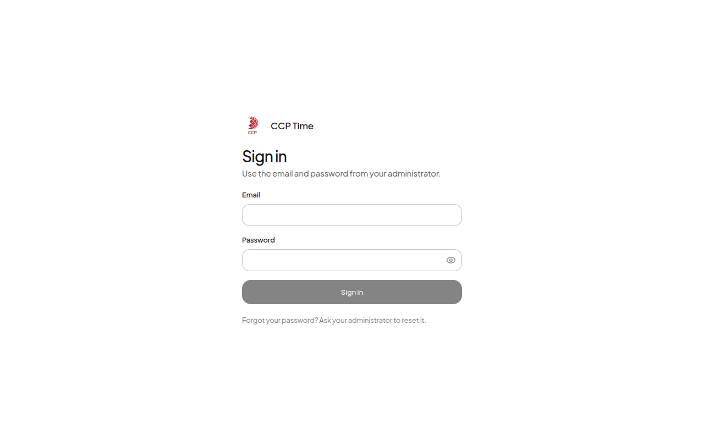

Forgotten your password? There is no self-service reset. Ask the CEO, who can issue a new temporary password.

### Getting around
- **On a computer:** the menu is on the left, grouped into *My work*, *Manage* (managers and CEO) and *Company* (CEO only). You only see the pages you are allowed to use.
- **On a phone:** tap the **☰** button at the top left to open the same menu from the bottom of the screen.
- **Your account menu** (your initials, top right) holds your **Profile**, the **theme** (light, dark or follow your device) and **Sign out**.

### Notifications
The **bell** at the top right shows a red count of unread notifications, and checks for new ones every minute. You'll be told when:
- you forgot to clock out (employees);
- a correction you asked for is approved or rejected (employees);
- a correction is waiting for your review (project managers and the CEO);
- you are added to a project.

Click a notification to mark it read and go straight to the right page.

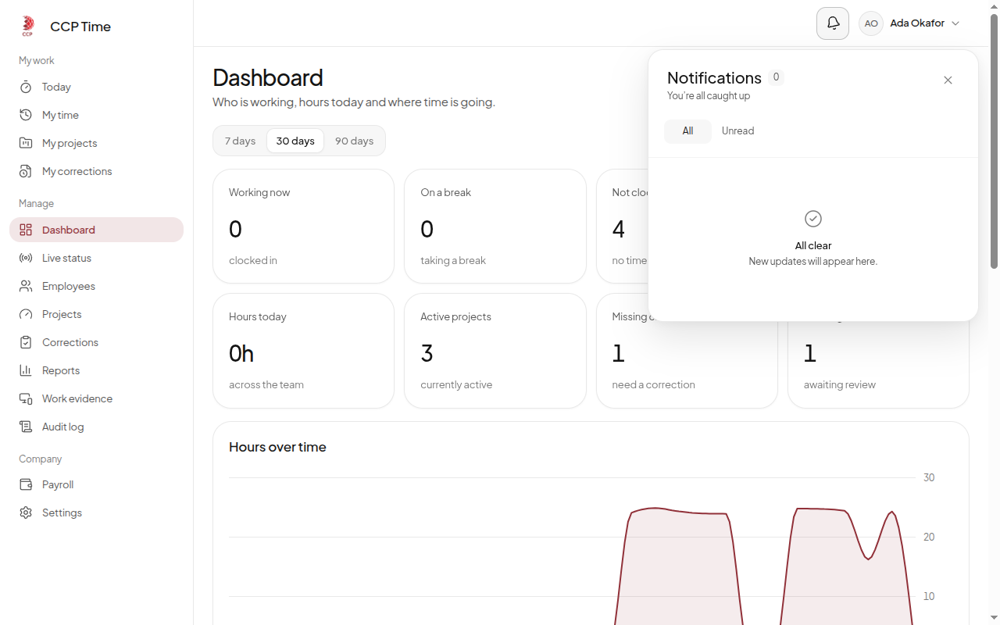

### Your profile
**Account menu → Profile** shows your details and lets you change your password. Enter your current password, then the new one twice.

---

## 2. Employees: recording your time

### The golden rule
**Start work when you begin, end work when you stop.** Everything else (hours, averages, pay) is worked out from those two moments and the breaks in between. The clock runs on the server, so it doesn't matter which device you use. You can start on your phone and end on your computer.

### Today: the punch clock
Open **Today**.

**To start work:**
1. Choose the **project** you are working on. You only see projects you have been added to; if one is missing, ask your project manager.
2. Choose **where** you are working: Office, Site, Remote or Other.
3. Choose **what you are doing**: Design, Drawing, Client meeting, Site inspection, Documentation, Administration or Other.
4. Optionally add a **note**, for example *"ground floor layout revisions"*.
5. Press **Start work**. The big timer starts counting.

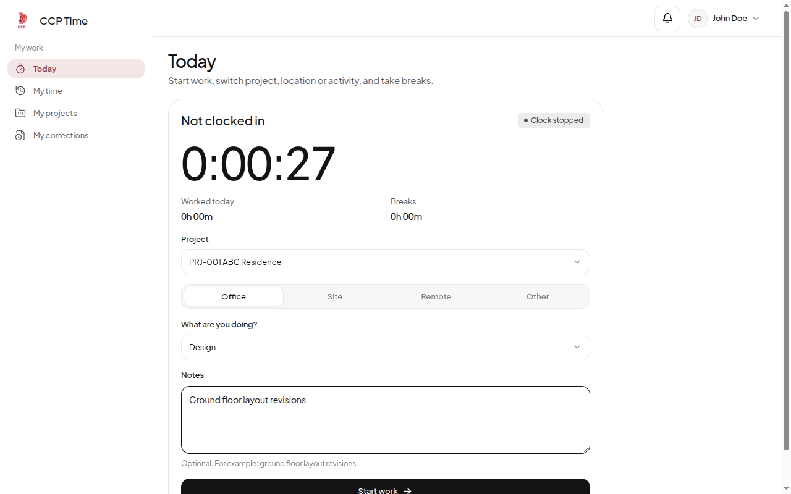

**While you work**, the screen shows:
- your time worked today;
- your breaks today;
- when you started, and the current project, location and activity.

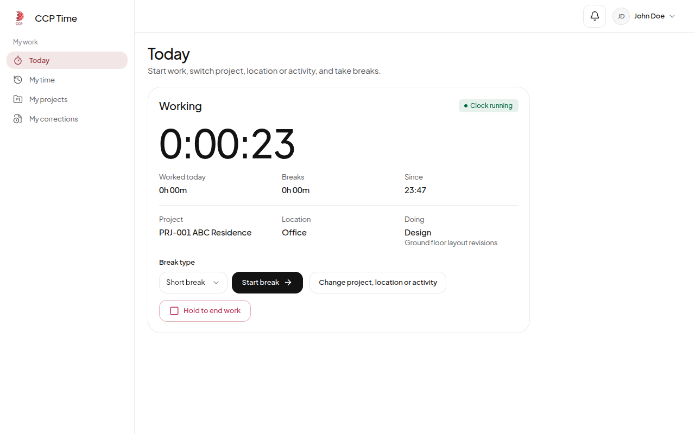

**When you switch tasks** (a different project, moving from office to site, or changing activity):
- Press **Change project, location or activity**, pick what changed, and press **Save change**.
- Your time so far stays with the old project or activity. New time goes to the new one.
- Do this as it happens, not at the end of the day. That's how project hours stay accurate.

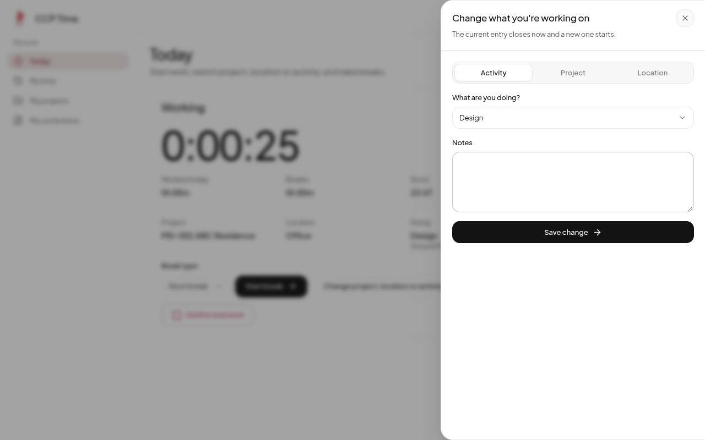

**Breaks:**
- Choose the break type (Lunch, Short break or Other) and press **Start break**. The work timer pauses.
- Press **End break** when you're back.
- Breaks are unpaid.
- While on a break you **cannot** change project, location or activity, or end work. End the break first.

**To end work:** press and **hold** the **Hold to end work** button until it fills. The hold stops you ending the day by accident.

### Forgot to clock out?
If you're still clocked in 16 hours after you started, the system marks that day as **missing a clock-out**. It does **not** guess when you stopped, so those hours count as zero until fixed. You'll get a notification. Ask for a correction (below) with the real time you finished.

### My time
**My time** lists your working days, newest first.
- Use the **date range** picker to look at any period.
- Each day shows hours worked (minus breaks), breaks, and a status:
  - **Open:** still in progress.
  - **Completed:** a normal finished day.
  - **Missing clock-out:** needs a correction.
  - **Correction pending:** waiting for your manager.
  - **Corrected:** fixed by an approved correction.
- Open a day to see each entry: which project, where, and from what time to what time.
- A day with a missing clock-out has a shortcut to request a correction.

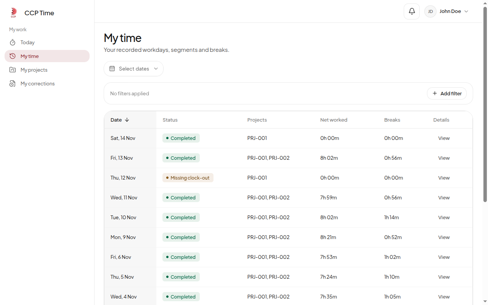

### My projects
**My projects** shows each project you're on and how many hours *you* have put into it over the chosen range. It never shows pay or project costs.

### My corrections: fixing a mistake
You can't edit your own time directly; every change is approved by a manager and recorded. To fix something:
1. Open **My corrections** and press **Request correction**. Or use the shortcut from a flagged day in My time.
2. Choose the **day**, then either:
   - pick an **existing entry** to fix its start or end time, or
   - add a **missing entry** for a project you forgot to clock in to.
3. Enter the correct times and a short **reason** (at least 5 characters), for example *"Stayed late to finish the layout; forgot to clock out."*
4. Submit. Your project manager (or the CEO) is notified.

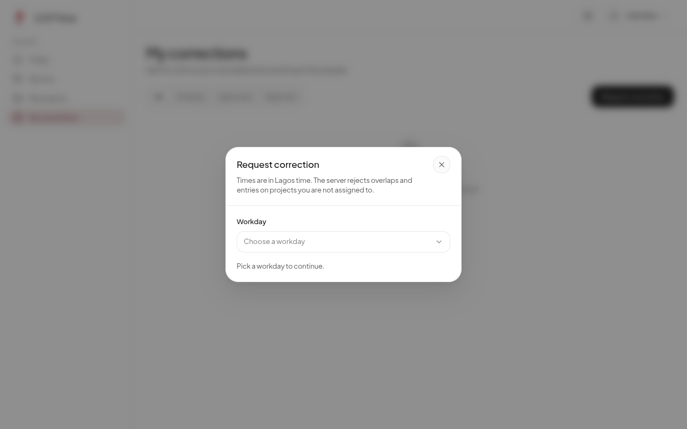

While a request is **pending** you can **Edit** it, or **Withdraw** it. The system refuses requests that overlap other recorded time, or that use a project you aren't on, and tells you why. You'll get a notification when it's decided, with the reviewer's note if they left one.

---

## 3. Project managers: running your projects

You have everything in part 2 for your own time, plus the **Manage** pages. You see data only for **people on projects you lead**, and you never see pay rates or costs.

### Dashboard
A snapshot of your team:
- **Cards:**
  - who is working now, on a break, not clocked in yet or finished for the day;
  - hours today;
  - active projects;
  - missing clock-outs;
  - corrections waiting for review.
- **Charts:**
  - hours over time (7, 30 or 90 days);
  - hours by project;
  - each active project's hours against its estimate;
  - hours by location and by activity.

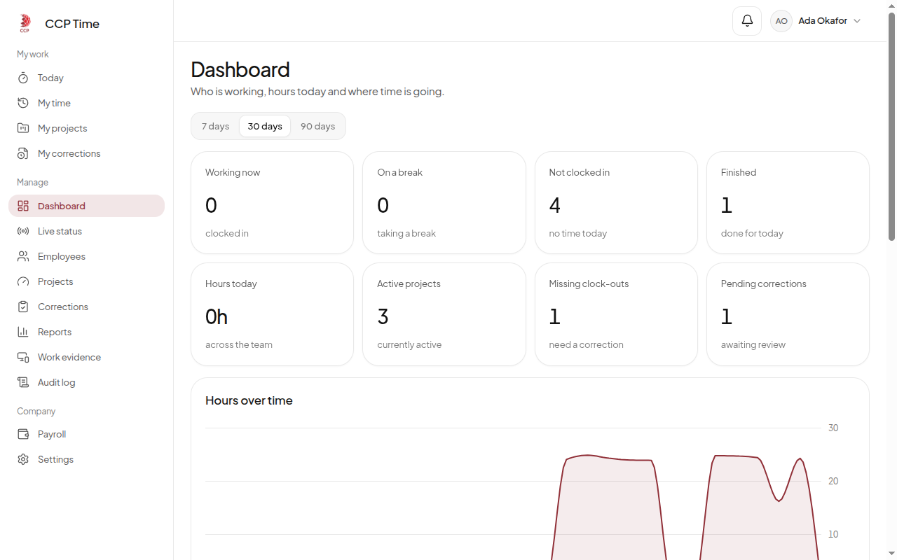

### Live status
Everyone in your scope right now: working, on a break, finished or not started, with their project, what they're doing and how long they've been at it. It refreshes every 15 seconds.

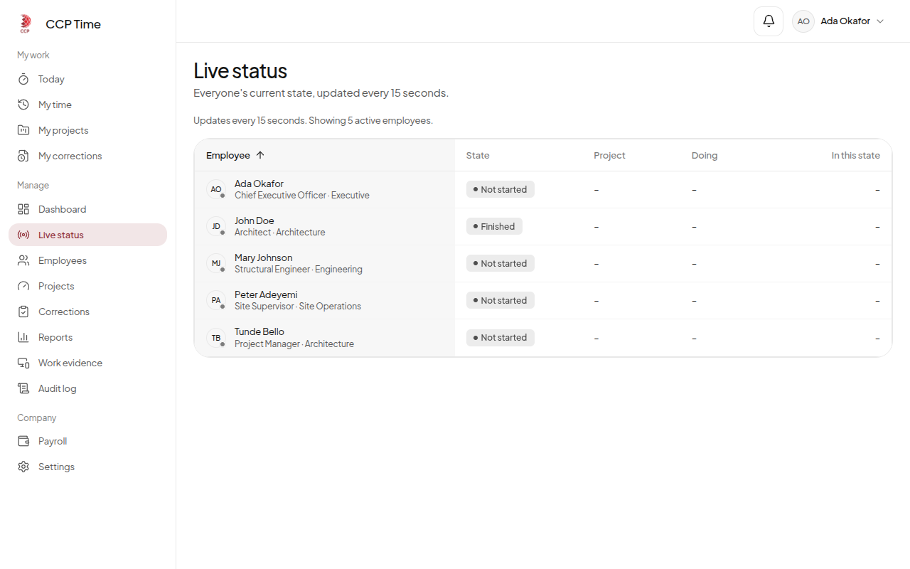

### Employees
A searchable staff list. Open a person to see:

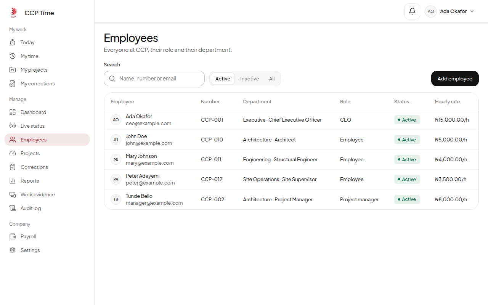

- **Overview:** their details, projects, and last-30-day numbers (hours, average day, missing clock-outs).
- **Report:** hours by project, activity and location for the last 30 or 90 days.

Only the CEO can add, edit or deactivate staff.

### Projects
The list shows each project you lead, its status, team size, and **hours against estimate** as a progress bar, flagged when a project goes over. Press **New project** to create one; you become its lead automatically.

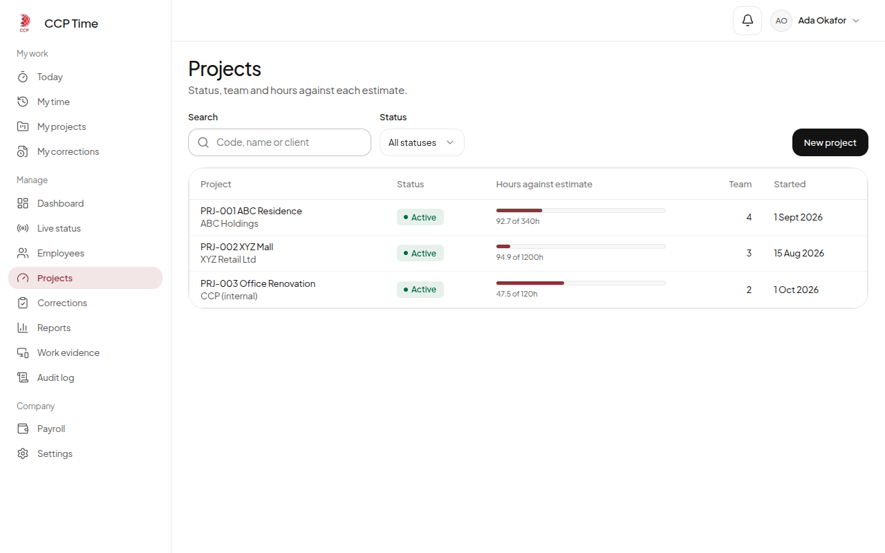

Inside a project:

- **Overview:** hours worked, the estimate, hours remaining (or how far over), project details, and who is working on it right now.

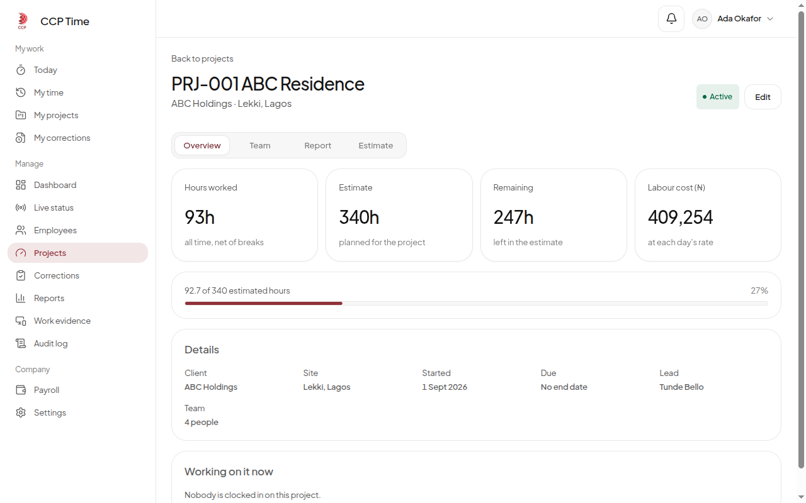

- **Team:** add people with the search box, or remove someone. Removing a person keeps every hour they already recorded; they just can't clock in to it any more. Only the CEO can make someone a lead or remove a lead.
- **Report:** hours by person, activity and location.
- **Estimate:** choose a team and see roughly **how many working days** the remaining work will take. It is based on each person's average working day over the last 90 days; anyone with no recent history is assumed to work 8 hours a day, and the page says so. It's a guide, not a promise.

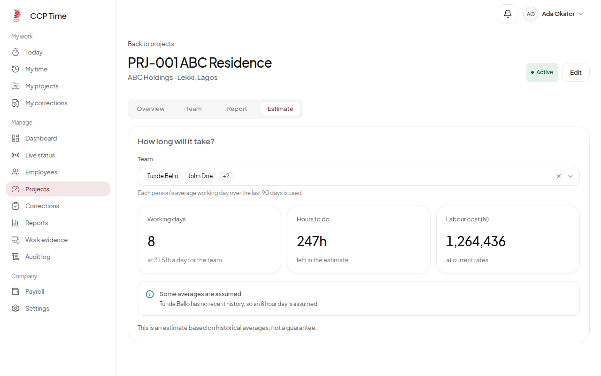

- **Edit:** change the name, client, site, dates, estimate or **status** (Planned, Active, On hold, Completed, Cancelled). People can only clock in to **Active** projects. A project that has time recorded can't be deleted, so change its status instead.

### Corrections: reviewing requests
1. Open **Corrections**. It shows **Pending** requests by default.
2. Press **Review** on a request. A panel shows what was **recorded** that day (the entry being changed is marked) next to what is **requested**, with the employee's reason.
3. Optionally add a note for the employee, then **Approve** or **Reject**.

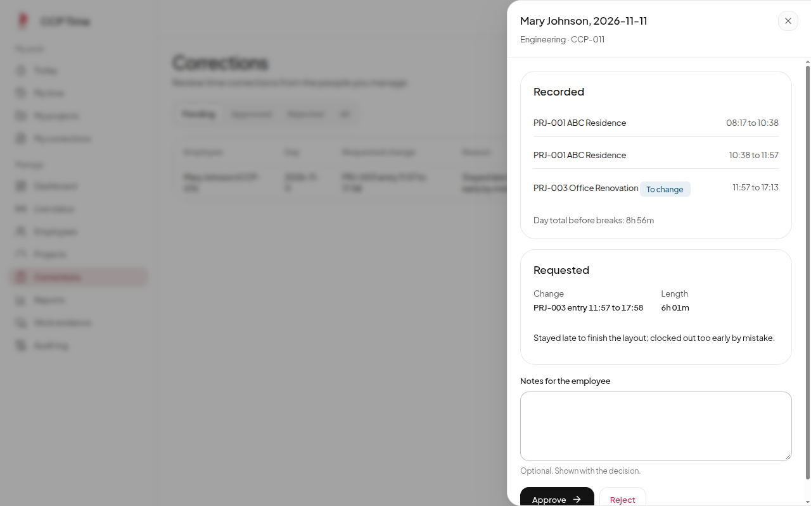

- **Approving** updates the day's record and recalculates its hours.
- **Rejecting** leaves the original record exactly as it was.
- You can't review your **own** requests; another manager or the CEO must.
- If someone else reviewed it a moment before you, the list refreshes and tells you.

### Reports
Pick an **employee** or a **project** and a date range to see hours by project, activity and location. It's the same information as the report tabs, without opening each record.

### Work evidence
Pick a person and a day to compare their **recorded time** with what their computer's activity agent reported: active time, long idle gaps, and which device. The page gives a plain assessment, for example *"Site work: reduced computer activity is expected"*. It's there to support a conversation, not to accuse anyone; site work, meetings and drawing by hand all show little computer activity.

### Audit log
Every change made in the system, who made it and when, with a before-and-after view. Project managers see the changes they made themselves. Entries can never be edited or deleted.

---

## 4. CEO (administrator): running the company

You see **everything**: all staff, all projects, pay rates, labour costs, payroll and settings. Everything in parts 2 and 3 applies to you as well, across the whole company.

### Adding a new employee
1. **Employees → Add employee.**
2. Fill in their name, work email, employee number (for example CCP-014), position, department, role (Employee, Project manager or CEO), hire date, **hourly rate** and **overtime rate** in naira.
3. Press **Add employee**. A **temporary password** appears **once**. Copy it with the copy button and give it to them privately. It's never shown again; if it's lost, reset it (below).
4. They must choose their own password at first sign-in.
5. Add them to their projects (**Projects → project → Team**) so they can clock in.

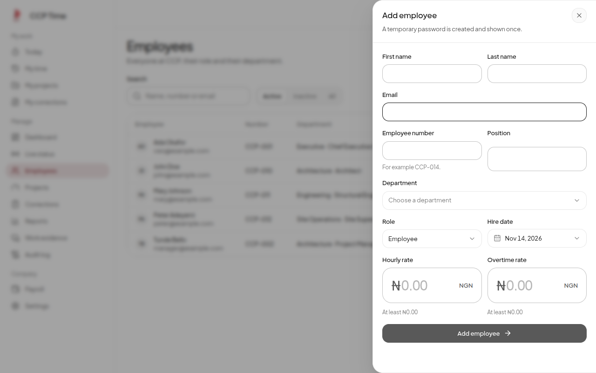

Departments come from **Settings**, so add a new department there first.

### Managing an existing employee
Open the person from **Employees**:
- **Edit:** name, email, number, position or department.
- **Reset password:** signs them out everywhere and shows a new temporary password once.
- **Deactivate:** they can no longer sign in, but all their history stays (for payroll and reports). People are never deleted.
- **Reactivate:** lets a deactivated person sign in again.

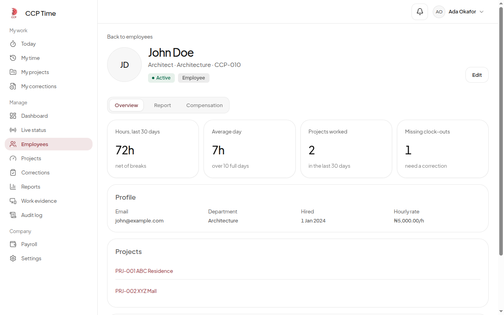

### Pay rates and rate history
Open a person → **Compensation**:
- The **rate history** lists every rate they've had and the dates it applied.
- To change a rate, enter the **new hourly rate**, the **new overtime rate** and the date it **starts on**, then **Save new rate**. The old rate ends the day before.
- Past days keep the rate that applied **at the time**, so a raise never changes pay already earned.

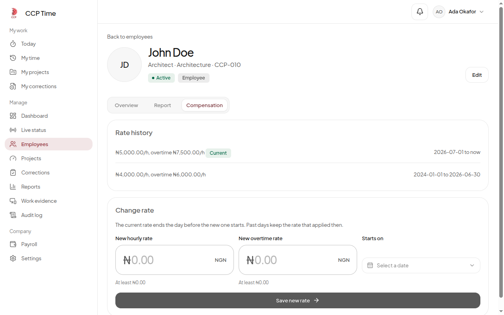

### How pay is worked out
- **Hours that count** are worked time minus breaks, on days that are *Completed* or *Corrected*.
- Each day is priced at the rate in force **on that day**.
- The first **8 hours** in a day are paid at the hourly rate; anything above 8 hours is overtime, paid at the overtime rate. (This 8-hour line is fixed for now.)
- A day with no rate on file is left out, and payroll warns you.

### Payroll
1. Open **Payroll** and pick the **pay period** (presets for this month and last month). A period can be up to 3 months, and periods for the same person can't overlap.
2. Press **Generate draft**. You'll see each person's regular hours, overtime hours, gross pay and hours per project, plus totals.
   - If any days have **no rate**, you're told how many. Add the rate on the person's Compensation tab and generate again.
   - You can **regenerate** a draft as often as you like until it is finalized.
3. **Export CSV** downloads the period as a spreadsheet for your accountant or bank.
4. When everything is right, **press and hold "Hold to finalize"**. Finalized records are **locked**: later corrections won't change them, and regenerating skips them.
   - Finalizing is refused while anyone has an open day, a missing clock-out or a pending correction in the period. The page lists those days; resolve them in Corrections, then try again.

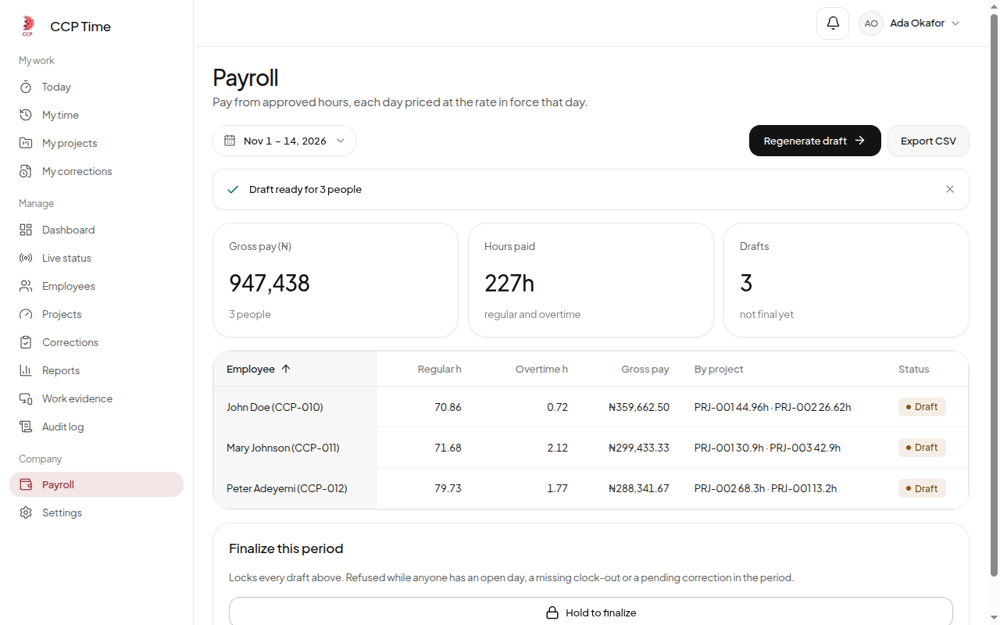

### Projects and leads
As well as everything in part 3, you can:
- **Make someone a project lead** (the *Make them a project lead* switch when adding to a team), and remove leads.
- See **labour cost** on a project's Overview and per person on its Report: the cost of the hours worked, at each day's rate.
- See the **estimated labour cost** on the Estimate tab, priced at current rates.

### Settings
- **Departments:** add new departments and rename existing ones. Renaming moves everyone in that department along with it.
- **Desktop devices:** the computers allowed to report activity for Work evidence.
  - **Register device:** pick the employee, name the computer, and enter its serial number or MAC address and its operating system.
  - A **device key** is shown **once**. Put it in the activity agent's settings file on that computer (see below).
  - **Revoke** a lost, sold or replaced computer. Its key stops working immediately.

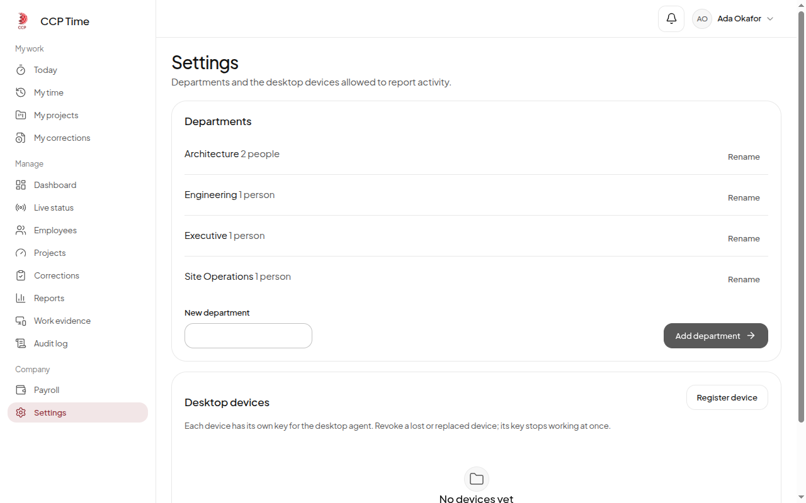

### Audit log
You see every action by everyone: sign-ins, clock-ins, edits, rate changes, approvals, payroll runs and device changes, each with before-and-after details.

---

## The desktop app and the activity agent

There are two separate desktop programs:

| Program | What it does | Needed? |
|---|---|---|
| **CCP Time desktop app** | The same web app in its own window, with a tray icon. Closing the window keeps it in the tray; quit from the tray menu. | Optional: the browser works just as well. |
| **Activity agent** (`desktop-agent`) | Runs quietly in the background and reports, once a minute, whether the computer is in use. It never records screens, keys or files. | Only if you want Work evidence for that computer. |

**To set up the activity agent on a computer:**
1. The CEO registers the device in **Settings → Desktop devices** and copies the key.
2. On that computer, copy `config.example.json` to `config.json` in the agent folder and fill in the server address, the device identifier (exactly as registered) and the key.
3. Start the agent. Activity appears in Work evidence for days that person works.

---

## Quick answers

**I can't see a project when starting work.** You haven't been added to it, or it isn't Active. Ask your project manager.

**I can't end work or change project.** You're on a break. Press **End break** first.

**My hours for yesterday show as zero.** You probably didn't clock out, so the day is marked *missing clock-out*. Request a correction with the time you actually finished.

**I made a mistake in a correction request.** If it's still pending, press **Edit** or **Withdraw** in My corrections.

**Why can't I finalize payroll?** Someone in the period has an unfinished day, a missing clock-out or a pending correction. The page lists them.

**A new employee can't be added to a department.** Add the department in **Settings** first.

**Someone left the company.** **Deactivate** them. Their hours stay in reports and payroll, but they can't sign in.

**A computer was lost.** **Revoke** it in **Settings → Desktop devices**.
